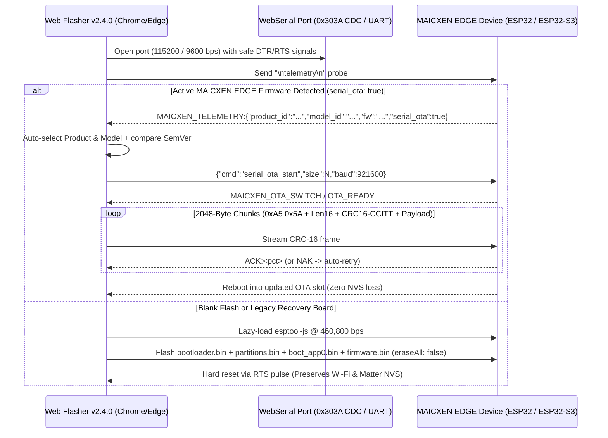

<div align="center">

# MAICXEN EDGE — Universal Web Flasher & Global OTA CDN (`MAICXEN-flasher`)

**Universal WebSerial Installer (`v2.4.0`) · Native `921,600` bps CRC-16/CCITT USB-FOTA · `esptool-js` Bootloader Fallback · Live USB Diagnostics · Global OTA Release Feeds**

[-0a84ff?style=for-the-badge&logo=googlechrome&logoColor=white)](https://iot.maicxen.it/)
[](https://github.com/MAICXEN-STUDIOS/MAICXEN-flasher)
[](https://iot.maicxen.it/?product=smarty)
[](https://iot.maicxen.it/?product=aleda)
[](https://iot.maicxen.it/?product=onir)

*Engineered by **MAICXEN EDGE***

</div>

---

## Table of Contents

1. [Overview & Standalone Repository Role](#1-overview--standalone-repository-role)
2. [Hybrid Dual-Mode USB Flashing Protocol](#2-hybrid-dual-mode-usb-flashing-protocol)
3. [Live USB Diagnostics & Developer Tools](#3-live-usb-diagnostics--developer-tools)
4. [Global OTA CDN & Manifest Structure](#4-global-ota-cdn--manifest-structure)
5. [Automated Synchronization & Deployment](#5-automated-synchronization--deployment)
6. [Directory Structure](#6-directory-structure)

---

## 1. Overview & Standalone Repository Role

`MAICXEN-flasher` (`EDGE/Tools/MAICXEN-flasher`) is the dedicated standalone repository (`https://github.com/MAICXEN-STUDIOS/MAICXEN-flasher.git`) for the **MAICXEN EDGE Universal Web Flasher (`v2.4.0`)** and the static Over-The-Air (OTA) firmware distribution tree served at [`https://iot.maicxen.it/`](https://iot.maicxen.it/).

- **Strict Inclusion Policy**: Only models in `EDGE/Products/<Series>/<Model>/model.json` with **`"deployable": true`** AND **`"has_firmware": true`** are registered in `MAICXEN-flasher`. Pure PCB/hardware projects (`has_firmware: false`, such as `DMXtool` or `Ponte H V3`) are automatically excluded.
- **Instant Non-Blocking Render**: Pre-seeded product profiles in [`shared/js/catalog-data.js`](shared/js/catalog-data.js) render immediately on page load and refresh dynamically from Supabase `public.product_catalog` (with `./catalog.json` fallback).
- **Capability-Aware Hardware SVGs**: Automatically renders bespoke Apple-style minimalist SVG hardware illustrations (`renderSmartySvg`, `renderAledaSvg`, `renderOnIrSvg`, or capability-matched dynamic SVGs) with live progress bars during USB flashing.

---

## 2. Hybrid Dual-Mode USB Flashing Protocol



### Partition Offsets by Architecture
- **ESP32-S3 (`8 MB` Dual-OTA)**: `0x0000` (`bootloader.bin`), `0x8000` (`partitions.bin`), `0x11000` (`boot_app0.bin`), `0x20000` (`firmware.bin`).
- **ESP32 Classic (`4 MB` Dual-OTA)**: `0x1000` (`bootloader.bin`), `0x8000` (`partitions.bin`), `0xE000` (`boot_app0.bin`), `0x10000` (`firmware.bin`).

---

## 3. Live USB Diagnostics & Developer Tools

`MAICXEN-flasher` features three segmented workspaces in [`index.html`](index.html):
1. **Flash**: Auto-discovery badge, segmented product switcher, hardware illustration stage, model selector, frosted-glass release notes popover, transfer protocol indicator, and 1-click USB flashing.
2. **Diagnostics**: Read-only live USB telemetry stream (`2.5s` polling interval) displaying Hardware ID, active OTA partition (`app0`/`app1`), operating state, Wi-Fi SSID & RSSI, clickable Local Web UI link (`http://<wifi_ip>`), SoC temperature, free heap RAM, and session/cumulative uptime, plus quick actions (`Refresh`, `Check Cloud FOTA`, `Reboot Device`).
3. **Tools**:
   - **Custom Local Firmware (`.bin`)**: Client-side `SHA-256` checksum computation and direct Native USB-FOTA streaming of local PlatformIO builds.
   - **Interactive USB Serial Console**: Send raw CLI or JSON commands over WebSerial and export session logs as `.txt`.
   - **Direct Assets**: 1-click download of `firmware.bin`, `version.json` inspection, and deep-link URL sharing (`https://iot.maicxen.it/?product=<id>&model=<model>`).

---

## 4. Global OTA CDN & Manifest Structure

Every connected MAICXEN EDGE device polls its model-specific HTTPS feed on boot and every 24 hours:
- **Global Catalog**: `https://iot.maicxen.it/catalog.json`
- **Per-Model OTA Feed**: `https://iot.maicxen.it/firmware/<product_id>/<model_id>/version.json`
- **Compiled Binary**: `https://iot.maicxen.it/firmware/<product_id>/<model_id>/firmware.bin`

---

## 5. Automated Synchronization & Deployment

`MAICXEN-flasher` is synchronized automatically whenever `pio run` completes in any firmware project or when running the root orchestrator:

```bash
# Sync all deployable firmware models into firmware/, catalog.json & shared/js/config.js
python3 ../../../scripts/ecosystem_sync.py

# Publish MAICXEN-flasher and iot.maicxen.it CDN live to GitHub Pages
python3 ./scripts/publish_ecosystem.py
```

---

## 6. Directory Structure

```text
MAICXEN-flasher/
├── index.html                        # Universal Web Flasher (v2.4.0)
├── catalog.json                      # Auto-synced global product & model manifest
├── README.md                         # Repository documentation
├── flasher/
│   ├── css/flasher.css               # Apple-minimalist dark UI stylesheet
│   └── js/
│       ├── main.js                   # UI controller, popover, local .bin SHA-256 & deep links
│       ├── serial-protocol.js        # WebSerial probe, 921.6k CRC-16 USB-FOTA & esptool-js
│       └── usb-diagnostics.js        # Read-only live USB telemetry controller
├── shared/
│   ├── assets/                       # Color & monochrome MAICXEN EDGE logos
│   ├── css/tokens.css                # Design system tokens
│   └── js/
│       ├── config.js                 # Platform versions (2.4.0 / 3.2.0) & USB_FOTA_MIN_VERSION
│       ├── version.js                # SemVer comparison & telemetry formatters
│       ├── catalog-data.js           # Product registry & capability-aware SVG illustrations
│       └── pcb-visualizer.js         # Hardware illustration bridge
├── firmware/
│   ├── aleda/esp32s3-matter/         # AledA v1.1.4 binaries & version.json
│   ├── smarty/esp32s3-std/           # Smarty v1.6.1 binaries & version.json
│   └── onir/esp32-matter/            # onIR v1.0.1 binaries & version.json
└── scripts/
    └── publish_ecosystem.py          # Delegates cloud deployment to root ecosystem_sync.py
```

---

<div align="center">

**© 2026 MAICXEN EDGE — All Rights Reserved**  
[Launch Web Flasher (`iot.maicxen.it`)](https://iot.maicxen.it/) · [Open Fleet Console (`iot.maicxen.it/dashboard/`)](https://iot.maicxen.it/dashboard/)

</div>
